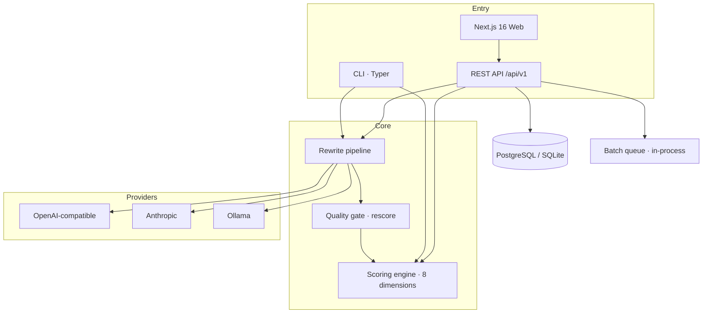

<div align="center">

# de-ai-ify

**Turn AI drafts into human writing.**

An explainable AI-text scorer and rewriter: score, explain, rewrite, then verify with a second score.

[](https://github.com/huayuehua15-netizen/de-ai-ify/actions/workflows/ci.yml)
[](https://github.com/huayuehua15-netizen/de-ai-ify/tags)
[](LICENSE)
[](https://github.com/huayuehua15-netizen/de-ai-ify/pkgs/container/de-ai-ify-api)
[](https://www.python.org/)
[](https://nextjs.org/)

[Quick start](#quick-start) · [Example](#example) · [Architecture](#architecture) · [Design trade-offs](#design-trade-offs)


</div>

---

## Why

LLM-generated Chinese tends to be formulaic: everything "is of great significance", every argument follows
"first, second, finally", sentences are suspiciously uniform in length, and the prose is full of nominalizations
("conduct", "implement", "improve") while saying very little that is concrete.

Those traits are measurable. de-ai-ify scores them across eight dimensions, points to the exact spans and reasons,
rewrites the text in a chosen style, then scores the result again to prove the rewrite actually helped.

## Features

| Feature | Detail |
|---|---|
| **Explainable 8-dimension score** | Clichés, sentence-length uniformity, connectives, nominalization, structural repetition, template phrases, vagueness, personalization; every hit returns span, reason and suggestion |
| **Register-aware weighting** | Detects academic / official / legal / technical / product / news / colloquial Chinese and reweights dimensions so formal documents are not flagged incorrectly |
| **Rewrite quality gate** | Five styles in parallel, with fact-anchor recall, length-ratio bounds and score-drop validation; retries when a rewrite fails the gate |
| **Diff and versions** | Word/character-level diff, side-by-side and inline views, multi-version tabs with adopt, undo and rescore |
| **Privacy by default** | Scoring is fully local; source text is not stored (`stored_text` stays NULL), history keeps only hash, length and scores |
| **Multiple entry points** | Web UI, REST API, CLI and Docker self-hosting on one engine |
| **Multiple providers** | OpenAI-compatible, Anthropic and Ollama adapters; 10 provider presets; API keys encrypted with Fernet |

Scoring works without any model key. Rewriting requires a provider configured in Settings or `.env`.

## Example


A full run: score → three style rewrites in parallel → quality gate → adopt → diff.
The UI data above uses the CI fake upstream (fixed output for reproducible tests).

Real-model measurement (SenseNova `sensenova-6.8-flash-lite`, 2026-11-23):

```text
Input:  80-point template prose ("in today's society ... first ... second ... finally ... in conclusion")
Output: 80 → 21, delta -59, gate pass, attempts 1

Streaming example: 77 → 55, delta -22, gate pass
```

## Architecture



Stack: Next.js 16 / React 19 / TypeScript / Tailwind CSS 4; FastAPI / SQLAlchemy 2 / Python 3.13;
PostgreSQL 15 + Redis 7 (standard) or SQLite (lite); Docker Compose, GitHub Actions and GHCR.

## Quick start

### Option 1: Docker (nothing to install locally)

**Prebuilt images (fastest)**

```bash
git clone https://github.com/huayuehua15-netizen/de-ai-ify.git
cd de-ai-ify
docker compose --profile full pull
docker compose --profile full up -d --no-build
```

**Or build locally**

```bash
docker compose --profile full up -d --build
```

Open http://localhost:3000 to score; API docs at http://127.0.0.1:8000/docs.

Images are published to GHCR as `ghcr.io/huayuehua15-netizen/de-ai-ify-api` and `-web`, for amd64 and arm64.
If the pull is unauthorized, make both packages public in GitHub Packages, or `docker login ghcr.io` and retry.

### Option 2: Local development

Requirements: Node ≥ 20.9, [pnpm](https://pnpm.io), [uv](https://docs.astral.sh/uv/); Docker for the standard stack.

```bash
pnpm install
docker compose up -d db redis   # skip for lite mode (SQLite)
pnpm dev                        # API on :8000 and web on :3000
```

```bash
pnpm check:env
pnpm lint
pnpm test
pnpm build
uv run --project apps/api deaiify doctor
```

## API and CLI

```bash
# Score: fully local, no model key required
curl -s http://127.0.0.1:8000/api/v1/analyze \
  -H "Content-Type: application/json" \
  -d '{"text":"In conclusion, AI is of great significance. First, it improves efficiency; second, it reduces cost."}'

# Rewrite: configure a provider first
curl -s http://127.0.0.1:8000/api/v1/rewrite \
  -H "Content-Type: application/json" \
  -d '{"text":"...","styles":["natural","concise"],"model":{"name":"your-model"}}'
```

```bash
deaiify analyze draft.md              # eight-dimension table and hits
deaiify analyze draft.md --strict     # exit 1 on high-severity hits (for CI)
deaiify batch ./drafts/ --style natural --out ./rewrites/
deaiify lex list
deaiify doctor
deaiify models
```

Exit codes: `0` success · `1` strict mode found high-severity hits or batch had failures · `2` configuration error.
Full endpoints and SSE protocol: [docs/DEVELOPMENT.md §7](docs/DEVELOPMENT.md).

## Engineering and tests

| Item | Status |
|---|---|
| Scoring engine | 8 dimensions, 961 bilingual terms, 7 registers; target < 100 ms for 10k characters (measured ~30 ms) |
| Backend tests | `134 passed, 1 skipped` (pytest; API, engine, corpus, privacy, batch) |
| Frontend tests | 23 Vitest unit tests + Playwright e2e (scoring, rewrite, diff, privacy persistence) |
| CI | 5 jobs: encoding check, ruff + pytest, PostgreSQL + Redis integration, web lint/build/unit/e2e, uv drift probe |
| Regression gate | AI corpus mean ≥ 65, human corpus mean ≤ 35; thresholds are not adjusted to make tests pass |
| Delivery | Docker Compose, multi-arch GHCR images, REST API, CLI, pre-commit checks |

## Design trade-offs

- **No LLM in scoring**: a rule engine is explainable, millisecond-fast, offline and private; LLM judging is an optional v2 experiment.
- **Decoupled score and rewrite**: every rewrite is rescored and its delta shown; the quality gate prevents regressions.
- **No source text by default**: history stores only hash, length and score; batch source text lives in memory, so rewritten text is intentionally lost on restart.
- **Single-instance first**: batch queue and rate limiting are in-process; this is not a multi-tenant SaaS.
- **Encrypted keys, honest boundary**: provider keys use Fernet; the master key lives next to the database, which protects against database leaks but not a compromised host.

### Known limitations

- Batch rewritten text is not retained after a restart (progress and scores are).
- Only five built-in styles; custom styles are not implemented yet.
- English text is supported, but register detection is Chinese-only; the corpus is not stratified by register.
- Rate limiting and batch queue are in-process; multiple replicas count independently.

## Repository layout

```
apps/web       Next.js 16 (App Router + Tailwind 4)
apps/api       FastAPI + SQLAlchemy 2, REST API, scoring engine and CLI
docker/        Dockerfile.api / Dockerfile.web, multi-stage, non-root
corpus/        Gold corpus for AI ≥65 / human ≤35 regression
docs/          Design document and screenshots
```

## Contributing

Issues and PRs are welcome. Please read [CONTRIBUTING.md](CONTRIBUTING.md),
[CODE_OF_CONDUCT.md](CODE_OF_CONDUCT.md) and [SECURITY.md](SECURITY.md) first.
See [CHANGELOG.md](CHANGELOG.md) for release history.

## License

[MIT](LICENSE)
