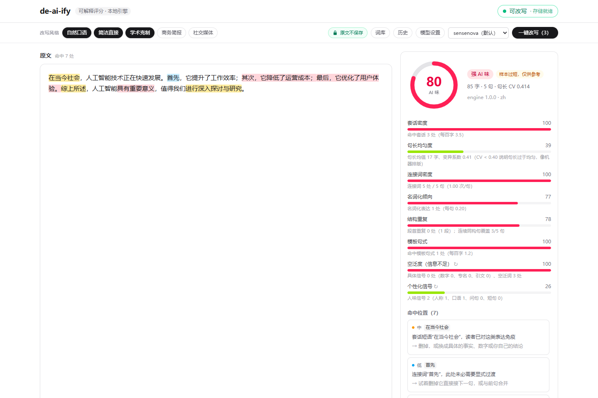

# de-ai-ify

[](https://github.com/huayuehua15-netizen/de-ai-ify/actions/workflows/ci.yml)
[](LICENSE)
[](https://www.python.org/)
[](https://nextjs.org/)

[中文](README.md) · **English**

> Make AI drafts read like a human wrote them.
> An explainable AI-text scorer and rewriter: find the boilerplate, the vague filler, the repetitive structure and the uniform sentence lengths — score it with reasons, rewrite it in one click, then verify the result.

**Status: v0.2.0 released · M0 scaffold ✅ · M1 scoring engine ✅ · M2 API + rewrite ✅ · M3 web client ✅ · M4 lexicons/privacy/providers ✅ · M5 CLI/Docker/docs ✅** (full design in [docs/DEVELOPMENT.md](docs/DEVELOPMENT.md))

---

## Why

LLM-written Chinese has a very consistent set of tics. Everything "is of great significance". Every argument
arrives as "first, second, finally". Sentences come out the same length as if typeset. The prose is full of
nominalizations — *carry out*, *realize*, *enhance* — and after reading the whole thing you cannot recall a
single concrete fact.

Those tics are **measurable**. de-ai-ify breaks them into eight dimensions, scores each one, points at the exact
span that triggered it and explains why, then rewrites the text and re-scores it to prove the rewrite actually
worked — instead of leaving you to guess whether something "sounds like AI".

## Features

- **Explainable scoring** across eight dimensions (clichés, sentence-length uniformity, connectives, nominalization, structural repetition, template phrasing, vagueness, personal signal), with per-hit spans, reasons and suggested fixes;
- **Register awareness**: detects academic / official / legal / technical / product / news / casual prose and re-weights the dimensions per register — so an official document's "一、二、三" or an academic "综上所述" is not mistaken for AI boilerplate (measured: human-written mean 19.4, AI sample 87);
- **Multi-style rewriting**: five styles (natural / concise / academic / business / social) in parallel, each re-scored afterwards with the delta shown;
- **Quality gate**: a rewrite must pass fact-anchor recall, a length-ratio window and a score drop; failures trigger exactly one retry;
- **Diff view**: word-level for English, character-level for Chinese, side-by-side or inline;
- **Custom lexicons**: disable any built-in term; add, edit, delete, and import/export as CSV or JSON;
- **Provider management**: add, test and switch providers in the UI (OpenAI / Anthropic / DeepSeek / Zhipu / Kimi / MiniMax / DashScope / Ollama / any OpenAI-compatible endpoint). Keys are encrypted at rest and never echoed back in plaintext;
- **Privacy by default**: scoring is fully local, **the original text is never stored by default**, and history can be wiped in one click;
- **Multiple entry points**: web UI, REST API, CLI and self-hosted Docker, all backed by the same engine.

## Screenshot



## What this is

This repository is a **self-hostable application** — not a hosted service and not a desktop client. Clone it,
run it on your own machine or server, and you get a web app.

| Form | How |
|---|---|
| Self-hosted web app | `docker compose --profile full up -d` or `pnpm dev`, then open `localhost:3000` |
| REST API | Call `/api/v1/*` and wire it into your own writing pipeline |
| CLI | `deaiify analyze ./draft.md`, `deaiify batch ./dir/` — batch processing and CI integration |
| Docker images | Published to GHCR (`ghcr.io/huayuehua15-netizen/de-ai-ify-api` / `-web`), pull and run |

**Scoring works out of the box**: the scorer and the highlighting are a purely local rule engine — no model, no
API key required. **Rewriting** needs a provider added on the “Model settings” page (or keys in `.env`):
any OpenAI-compatible endpoint, Anthropic, or a local Ollama.

Out of scope for v1: multi-tenant SaaS, desktop client, browser extension, platform skills
(see [docs/DEVELOPMENT.md §17.3](docs/DEVELOPMENT.md)).

## Quick start

### Option 1: Docker (nothing to install locally)

**Use the prebuilt images (fastest, no local build)**

```bash
git clone https://github.com/huayuehua15-netizen/de-ai-ify.git
cd de-ai-ify
docker compose --profile full pull
docker compose --profile full up -d --no-build
```

> Images are published to GHCR: `ghcr.io/huayuehua15-netizen/de-ai-ify-api` / `-web`.
> If the pull is unauthorized, make both packages public in GitHub Packages, or run `docker login ghcr.io` and retry.

**Or build the images locally**

```bash
docker compose --profile full up -d --build
```

Open http://localhost:3000 to start scoring; API docs at http://127.0.0.1:8000/docs.

Containers and ports: `deaiify-api` (127.0.0.1:8000), `deaiify-web` (127.0.0.1:3000),
`deaiify-db` (PostgreSQL 15, 127.0.0.1:5433), `deaiify-redis` (127.0.0.1:6380).

> Storage only, with the app hot-reloading on the host: `docker compose up -d db redis`.
> Before exposing to the internet, set `DEAIIFY_API_KEY` and change the `127.0.0.1` bindings in `ports`.

### Option 2: Local development

Requires Node ≥ 20.9, [pnpm](https://pnpm.io) and [uv](https://docs.astral.sh/uv/); Docker for the standard stack.

```bash
# 1) Frontend dependencies
pnpm install

# 2) Storage (PostgreSQL + Redis). Skip if you have no Docker and use lite mode — see .env.example
docker compose up -d db redis

# 3) Start API (:8000) and web (:3000) together
pnpm dev
```

The first run creates a Python 3.13 virtualenv via uv and installs backend dependencies.

Useful commands:

```bash
pnpm check:env    # environment self-check
pnpm lint         # ruff + eslint
pnpm test         # pytest
pnpm build        # next build
uv run --project apps/api deaiify doctor   # storage connectivity + engine version
```

## CLI

```bash
# Score — fully local, no model needed
deaiify analyze draft.md              # width-aligned tables (CJK-aware) with hit details
deaiify analyze draft.md --json       # structured output, pipe-friendly
deaiify analyze draft.md --strict     # exit 1 if any high-severity hit (for CI)

# Batch
deaiify batch ./drafts/ --style natural --out ./rewritten/

# Lexicons
deaiify lex list                      # term counts per layer, zh and en
deaiify lex disable 综上所述 --layer cliches
deaiify lex export lex.json --layer cliches --lang zh

# Diagnostics
deaiify doctor                        # storage connectivity + engine version
deaiify models                        # probe all three providers in parallel
```

Exit codes: `0` success · `1` `analyze --strict` found high severity, or `batch` had failures · `2` config error.

## API

OpenAPI docs at `http://127.0.0.1:8000/docs`.

```bash
# Score — fully local, no API key needed
curl -s http://127.0.0.1:8000/api/v1/analyze \
  -H "Content-Type: application/json" \
  -d '{"text":"综上所述，人工智能具有重要意义。首先，它提升效率；其次，它降低成本。"}'

# Rewrite — add a provider first (Model settings page, or DEAIIFY_OPENAI_BASE_URL / _API_KEY in .env)
curl -s http://127.0.0.1:8000/api/v1/rewrite \
  -H "Content-Type: application/json" \
  -d '{"text":"...","styles":["natural","concise"],"model":{"name":"your-model"}}'
```

> Windows PowerShell: inline JSON quoting is easily mangled by curl. Write the body to a UTF-8 file and use
> `--data-binary "@body.json"`.

## Architecture

```
apps/web    Next.js 16 (App Router + Tailwind 4) — web client
apps/api    FastAPI + SQLAlchemy 2.1 (Python 3.13, uv) — REST API / scoring engine / CLI
docker/     Dockerfile.api / Dockerfile.web — multi-stage, non-root
corpus/     Golden corpus (AI samples must score ≥65, human samples ≤35 — the regression gate)
```

Storage: **PostgreSQL 15 + Redis 7 (Docker) is the standard stack**. Without Docker you can run lite mode
(SQLite + in-process queue) — see [.env.example](.env.example).

## Privacy

Scoring runs locally. By default the original text is never written to the database and never logged.
History rows keep **only a hash, the character count and the scores**; `stored_text` stays NULL.
Text is sent to a model provider only when you configure a cloud provider and run a rewrite.
Saving the original additionally requires `DEAIIFY_STORE=optin` **and** an explicit per-request flag.

Provider keys are encrypted with Fernet (AES-128-CBC + HMAC-SHA256). The master key lives in
`DEAIIFY_SECRET_KEY` or `.deaiify-secret` at the repo root (gitignored). **The master key sits on the same
machine: this protects against database leaks, not against a local attacker with filesystem access.**
For multi-tenant deployments use KMS/Vault. See [SECURITY.md](SECURITY.md).

## Documentation

The full design — scoring spec, API contract, data model, milestones — is in
[docs/DEVELOPMENT.md](docs/DEVELOPMENT.md) (Chinese).

## Contributing

Issues and PRs are welcome. Please read first:

- [CONTRIBUTING.md](CONTRIBUTING.md) — setup, commit conventions, PR requirements
- [CODE_OF_CONDUCT.md](CODE_OF_CONDUCT.md) — community code of conduct
- [CHANGELOG.md](CHANGELOG.md) — change log
- [SECURITY.md](SECURITY.md) — how to report vulnerabilities (**please do not open a public issue**)

If you touch the scoring rules: the `corpus/` regression must stay green (AI ≥65 / human ≤35), and the
thresholds are not to be relaxed to make a change pass.

## License

[MIT](LICENSE)
