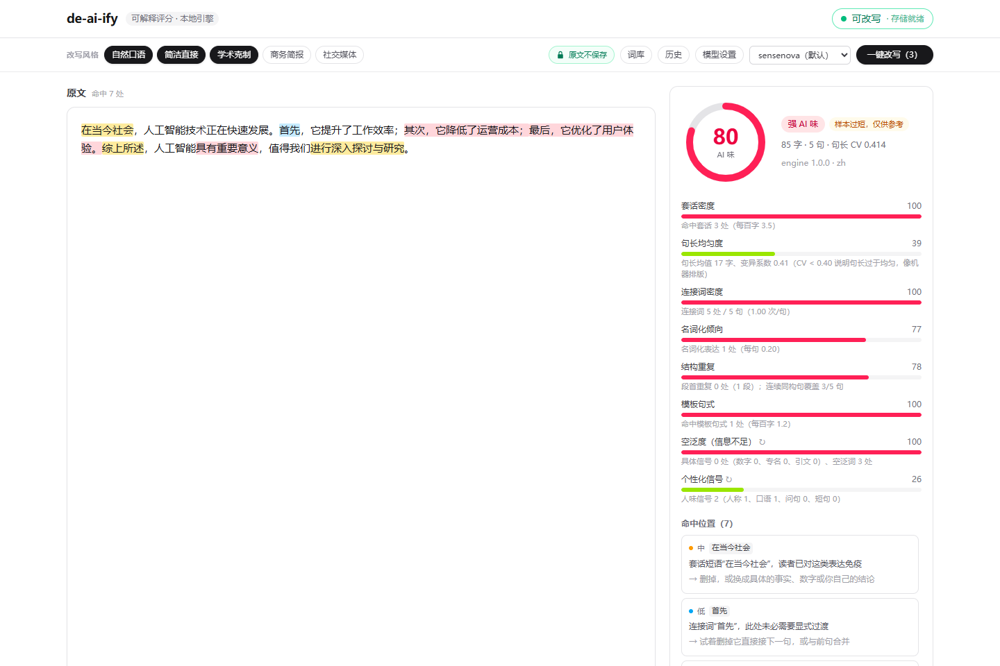
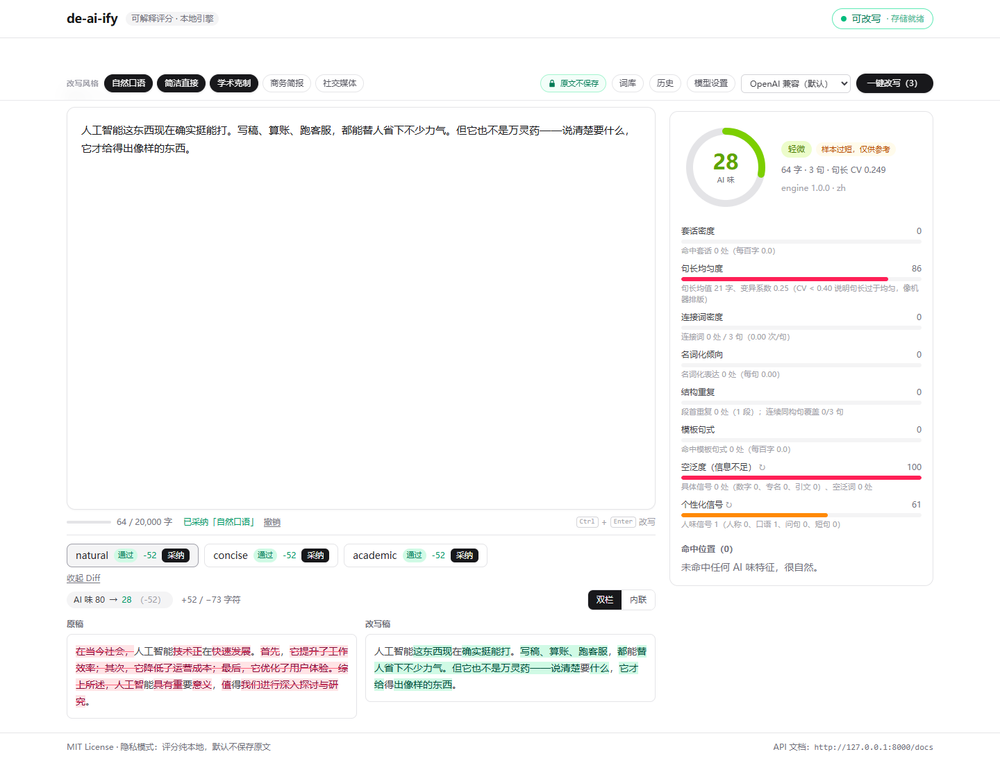
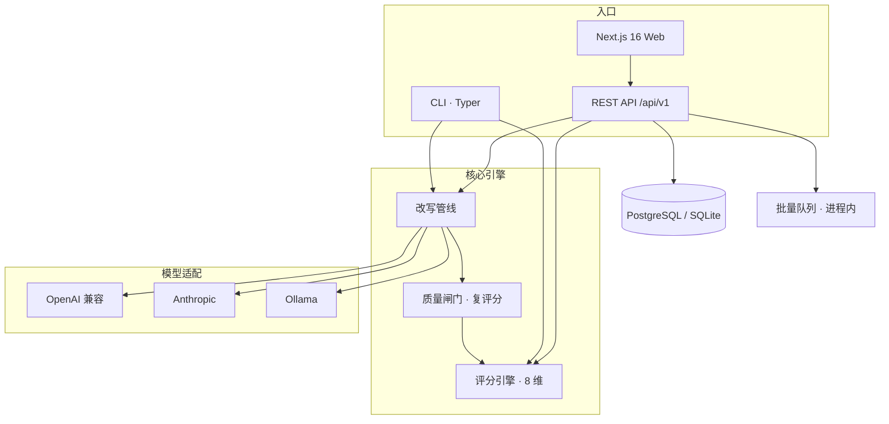

<div align="center">

# de-ai-ify

**把 AI 草稿，改成人写的。**

可解释的 AI 文本评分与改写工具：先评分解释，再一键改写，最后重新评分验证。

[](https://github.com/huayuehua15-netizen/de-ai-ify/actions/workflows/ci.yml)
[](https://github.com/huayuehua15-netizen/de-ai-ify/tags)
[](LICENSE)
[](https://github.com/huayuehua15-netizen/de-ai-ify/pkgs/container/de-ai-ify-api)
[](https://www.python.org/)
[](https://nextjs.org/)

[快速开始](#快速开始) · [效果示例](#效果示例) · [架构](#架构) · [API 与 CLI](#api-与-cli) · [设计取舍](#设计取舍)



</div>

---

## 为什么做这个

大模型写出来的中文有一套很固定的毛病：什么都能"具有重要意义"，凡事都要"首先、其次、最后"，
句子长度整齐得像排版过的，正文里全是"进行/实现/提升"这类名词化表达，读完整篇却记不住一个具体事实。

这些特征**是可测量的**。de-ai-ify 把它们拆成八个维度逐条打分，指出具体位置和原因，再改写成更自然的表达，
最后重新评分验证改写是否真的有效——而不是让你凭感觉判断"看起来像不像 AI 写的"。

## 核心能力

| 能力 | 说明 |
|---|---|
| **8 维可解释评分** | 套话 / 句长均匀度 / 连接词 / 名词化 / 结构重复 / 模板句式 / 空泛度 / 个性化信号；每条命中返回原文区间、原因与修改建议 |
| **文体感知** | 自动识别学术 / 公文 / 法律 / 技术 / 产品 / 新闻 / 口语 7 类文体，按文体重排维度权重，避免把公文"一、二、三"误判成 AI 套话 |
| **改写质量闸门** | 5 种风格并行改写，按事实锚点召回、字数比区间、分数下降三重校验；不达标自动重试，失败版本明确标记 |
| **Diff 与多版本** | 词级 / 字符级对比，双栏与内联两种视图；多版本 Tabs 可采纳、撤销、重新评分 |
| **隐私默认** | 评分纯本地完成，原文默认不落库；历史只保存哈希、字数与分数，`stored_text` 恒为 NULL |
| **多入口** | 同一引擎同时服务 Web、REST API、CLI 与 Docker 自托管 |
| **多供应商** | OpenAI 兼容端点 / Anthropic / Ollama 三类适配器，内置 10 个供应商预设，密钥 Fernet 加密存储 |

评分开箱即用，不需要任何模型 key。改写需要配置一个供应商（Web「模型设置」页或 `.env`）。

## 效果示例



上图是完整链路的界面演示：评分 → 3 个风格并行改写 → 质量闸门 → 采纳 → Diff。
界面数据来自 CI 同款假上游（固定输出，便于稳定复现）。

真实模型实测（商汤日日新 `sensenova-6.8-flash-lite`，2026-11-23）：

```text
输入：80 分模板腔（"在当今社会……首先……其次……最后……综上所述"）
输出：80 → 21，Δ −59，gate pass，attempts 1

流式输出：77 → 55，Δ −22，gate pass
"人工智能这东西，确实能派上大用场。一方面，干活的效率提上去了；
 另一方面，成本也压下来了。所以，它值得被认真对待。"
```

## 架构



技术栈：Next.js 16 / React 19 / TypeScript / Tailwind CSS 4；FastAPI / SQLAlchemy 2 / Python 3.13；
PostgreSQL 15 + Redis 7（标准栈）或 SQLite（lite 模式）；Docker Compose + GitHub Actions + GHCR。

## 快速开始

### 方式一：Docker（推荐，无需本地装 Python / Node）

**用预构建镜像（最快，首次不用等构建）**

```bash
git clone https://github.com/huayuehua15-netizen/de-ai-ify.git
cd de-ai-ify
docker compose --profile full pull
docker compose --profile full up -d --no-build
```

**或本地构建镜像**

```bash
docker compose --profile full up -d --build
```

打开 http://localhost:3000 即可评分；API 文档在 http://127.0.0.1:8000/docs。

镜像与端口：`deaiify-api`（127.0.0.1:8000）、`deaiify-web`（127.0.0.1:3000）、
`deaiify-db`（PostgreSQL 15，127.0.0.1:5433）、`deaiify-redis`（Redis 7，127.0.0.1:6380）。

> 镜像发布在 GHCR：`ghcr.io/huayuehua15-netizen/de-ai-ify-api` / `-web`，支持 amd64 / arm64。
> 只想要存储、应用在宿主机热重载：`docker compose up -d db redis`。

### 方式二：本地开发

前置：Node ≥ 20.9、[pnpm](https://pnpm.io)、[uv](https://docs.astral.sh/uv/)；标准栈还需 Docker。

```bash
pnpm install
docker compose up -d db redis   # 无 Docker 可跳过，用 lite 模式（SQLite）
pnpm dev                        # 同时启动 API :8000 与 Web :3000
```

首次会自动用 uv 创建 Python 3.13 虚拟环境并安装依赖。

```powershell
pnpm check:env    # 环境自检
pnpm lint         # ruff + eslint
pnpm test         # pytest + vitest
pnpm build        # next build
uv run --project apps/api deaiify doctor   # 存储连通性 + 引擎版本
```

## API 与 CLI

```bash
# 评分：纯本地，不需要任何模型 key
curl -s http://127.0.0.1:8000/api/v1/analyze \
  -H "Content-Type: application/json" \
  -d '{"text":"综上所述，人工智能具有重要意义。首先，它提升效率；其次，它降低成本。"}'

# 改写：需先配置供应商
curl -s http://127.0.0.1:8000/api/v1/rewrite \
  -H "Content-Type: application/json" \
  -d '{"text":"……原文……","styles":["natural","concise"],"model":{"name":"你的模型名"}}'
```

```bash
# CLI：评分 / 批量 / 词库 / 诊断
deaiify analyze 文稿.md              # 八维表格 + 命中详情
deaiify analyze 文稿.md --strict     # 有 high severity 命中时退出码 1（CI 用）
deaiify batch ./文稿目录/ --style natural --out ./改写结果/
deaiify lex list                     # 各层中英词条数
deaiify doctor                       # 存储连通性 + 引擎版本
deaiify models                       # 三个 provider 并行探测
```

退出码契约：`0` 成功 · `1` `analyze --strict` 有 high severity 或 `batch` 有失败 · `2` 配置错误。
完整端点与 SSE 协议见 [docs/DEVELOPMENT.md §7](docs/DEVELOPMENT.md)。

## 工程化与测试

| 项目 | 现状 |
|---|---|
| 评分引擎 | 8 维、961 条中英双语词库、7 类文体；1 万字分析目标 < 100ms（实测约 30ms） |
| 后端测试 | `134 passed, 1 skipped`（pytest，含 API / 引擎 / corpus / 隐私 / 批量） |
| 前端测试 | 23 个 Vitest 单测 + Playwright e2e（评分、改写、Diff、隐私落库） |
| CI | 5 个 job：编码检查、ruff + pytest、PostgreSQL + Redis 集成、前端 lint/build/单测/e2e、uv 漂移探针 |
| 回归门槛 | AI 样本均分 ≥ 65，人写样本均分 ≤ 35；不为凑分修改验收线 |
| 交付 | Docker Compose 全栈、GHCR 多架构镜像、REST API、CLI、pre-commit 自检 |

## 设计取舍

- **评分不用 LLM**：规则引擎可解释、毫秒级、可离线、默认隐私；LLM 判别只作为 v2 可选实验。
- **评分与改写解耦**：改写后必须重新评分并展示 Δ，质量闸门防止"改完更差"。
- **默认不存原文**：历史只存哈希、长度与分数；批量任务正文只留在内存，重启后正文丢失是有意取舍。
- **单实例优先**：批量队列与限流都在进程内，明确不做多租户 SaaS；需要多副本时应在网关层限流并引入共享队列。
- **密钥加密但不神化**：供应商密钥使用 Fernet 加密；主密钥与数据库同机，能防数据库泄露，不防本机文件系统攻击者。

### 已知限制

- 批量改写结果在服务重启后不保留正文（进度与分数仍在）。
- 仅支持 5 种内置风格，自定义风格尚未实现。
- 英文文本可用，但暂不做文体细分；corpus 未按文体分层。
- 限流与批量队列为进程内实现，多实例部署时各自独立。

## 仓库结构

```
apps/web       Next.js 16（App Router + Tailwind 4）— Web 入口
apps/api       FastAPI + SQLAlchemy 2 — REST API / 评分引擎 / CLI
docker/        Dockerfile.api / Dockerfile.web — 多阶段构建，非 root 运行
corpus/        金标准语料 — AI ≥65 / 人写 ≤35 回归门槛
docs/          开发文档与界面截图
```

## 参与贡献

欢迎 Issue 和 PR。开始之前请先读：

- [CONTRIBUTING.md](CONTRIBUTING.md) — 环境搭建、提交约定、PR 要求
- [CODE_OF_CONDUCT.md](CODE_OF_CONDUCT.md) — 社区行为准则
- [SECURITY.md](SECURITY.md) — 漏洞报告渠道（请勿公开提 Issue）
- [CHANGELOG.md](CHANGELOG.md) — 变更记录

## License

[MIT](LICENSE)
